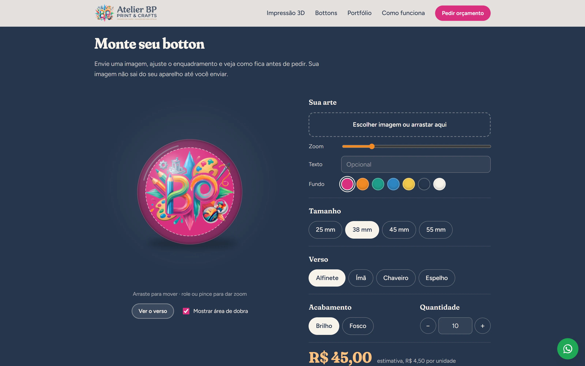
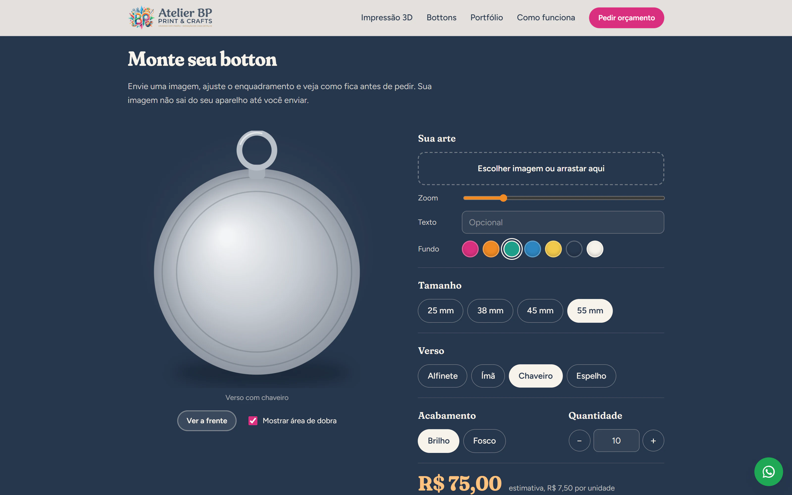
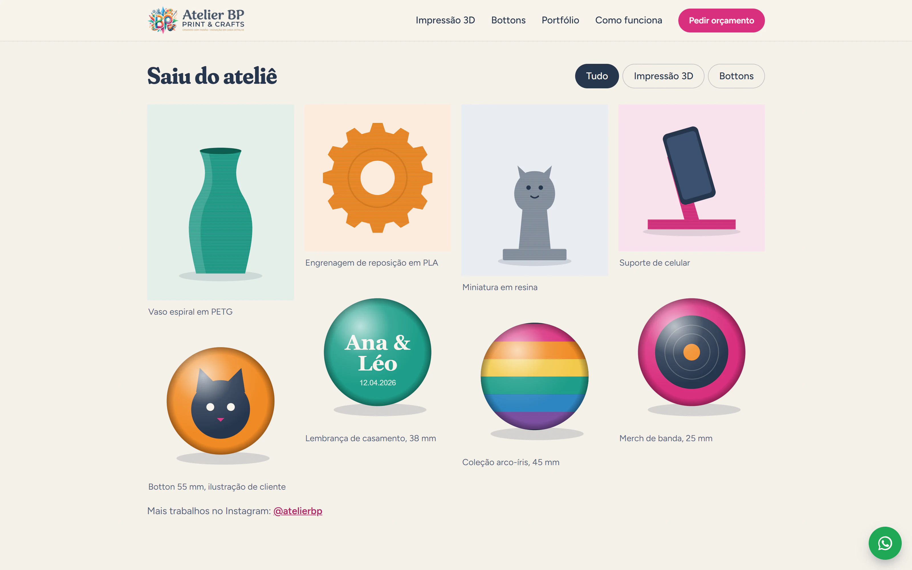
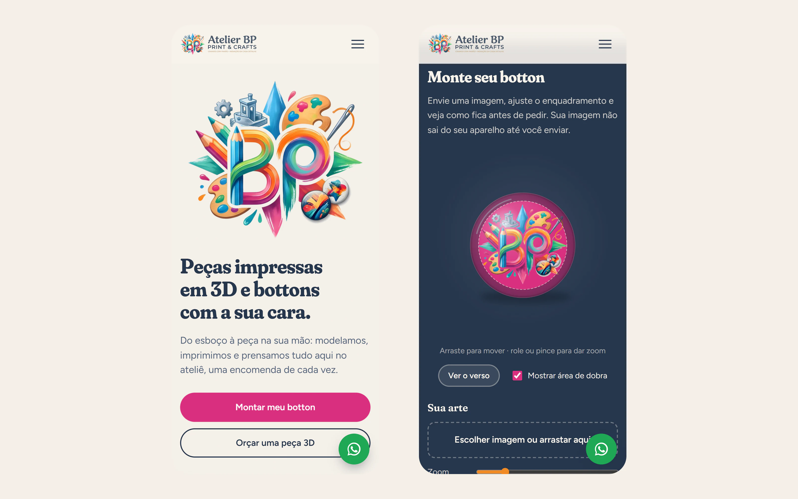

## Contexto

O Atelier BP é um ateliê de **impressão 3D e bottons personalizados**: peças sob medida em filamento ou resina e bottons prensados um a um. O site, ainda em desenvolvimento, apresenta os dois serviços e leva o cliente a pedir orçamento pelo WhatsApp.

## Desafio

- **Mostrar o produto antes de existir.** Quem encomenda um botton quer ver como a própria arte vai ficar, com o corte e a dobra da borda.
- **Orçamento sem ida e volta.** Preço por tamanho, quantidade e tipo de verso precisava aparecer na hora, e o pedido tinha que chegar ao ateliê já completo.
- **Peças 3D são abertas demais para um configurador.** Para elas, o caminho é um formulário que organize a ideia do cliente.

## Solução

Um site estático, sem framework, com a identidade colorida do ateliê. No topo, o emblema do Atelier BP é "impresso" camada por camada, com o bico de uma impressora 3D subindo junto, como acontece numa impressão de verdade.

### Monte seu botton

O configurador desenha o botton num **canvas**: a arte enviada pelo cliente, a área que dobra para trás, o brilho do acetato e a sombra. Dá para arrastar e dar zoom na imagem, escrever um texto, trocar a cor de fundo e escolher tamanho (25 a 55 mm), acabamento (brilho ou fosco) e quantidade. A estimativa de preço se atualiza a cada mudança, com desconto por faixa de quantidade.

Ao escolher o verso, a prévia vira e mostra o acabamento: alfinete, ímã de geladeira, chaveiro ou espelho de bolso.

A imagem do cliente é processada só no navegador: ela não sai do aparelho até ele decidir enviar. O botão de pedido abre o WhatsApp com tudo já escrito (tamanho, verso, acabamento, quantidade e valor), e a prévia pode ser baixada em PNG para anexar à conversa.

### Portfólio e orçamento 3D

A galeria tem filtro entre impressão 3D e bottons. As ilustrações abaixo guardam o lugar das fotos reais das peças, que entram quando o site for publicado. O orçamento de peças 3D é um formulário curto (o que imprimir, uso, material, tamanho, cor e link do modelo) que também vira uma mensagem de WhatsApp.

### No celular

O layout se reorganiza em uma coluna no celular, e o configurador aceita arrastar e pinçar para ajustar a arte.

## Situação

O site está em desenvolvimento. A estrutura, o configurador e os formulários estão prontos. Faltam os dados de contato definitivos, as fotos reais do portfólio e a publicação.
