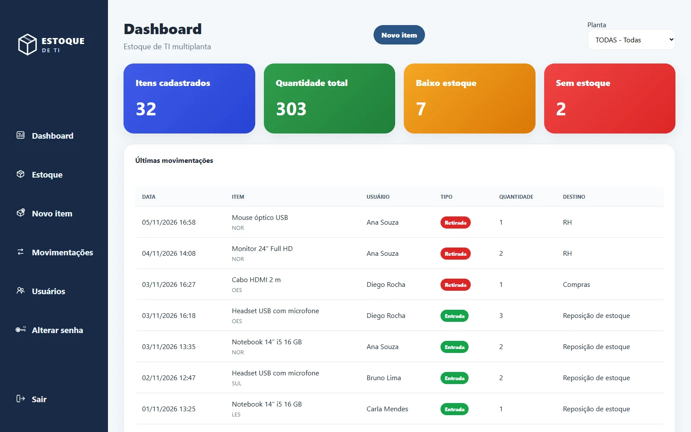
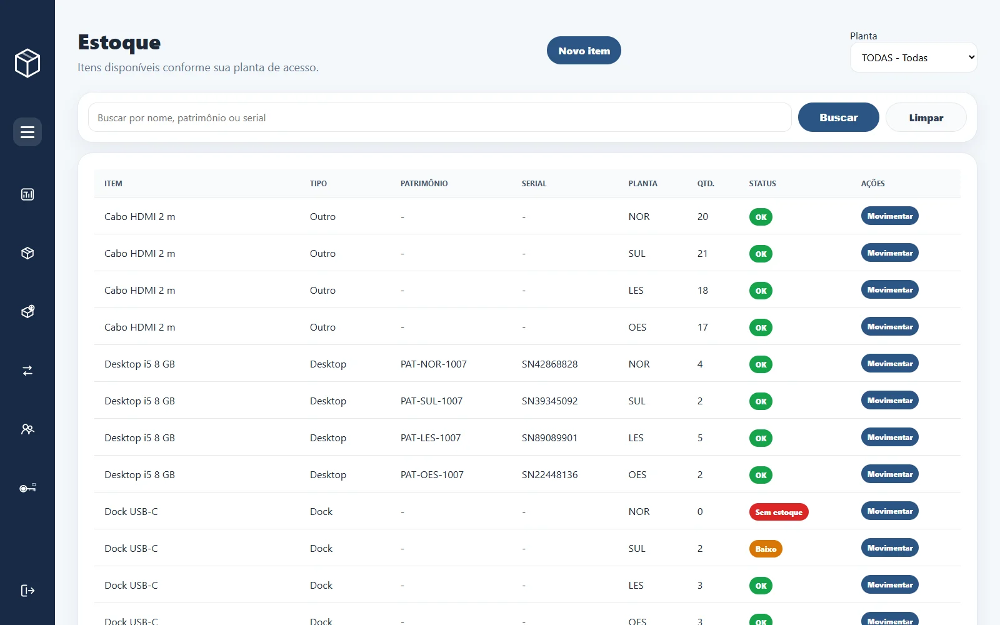
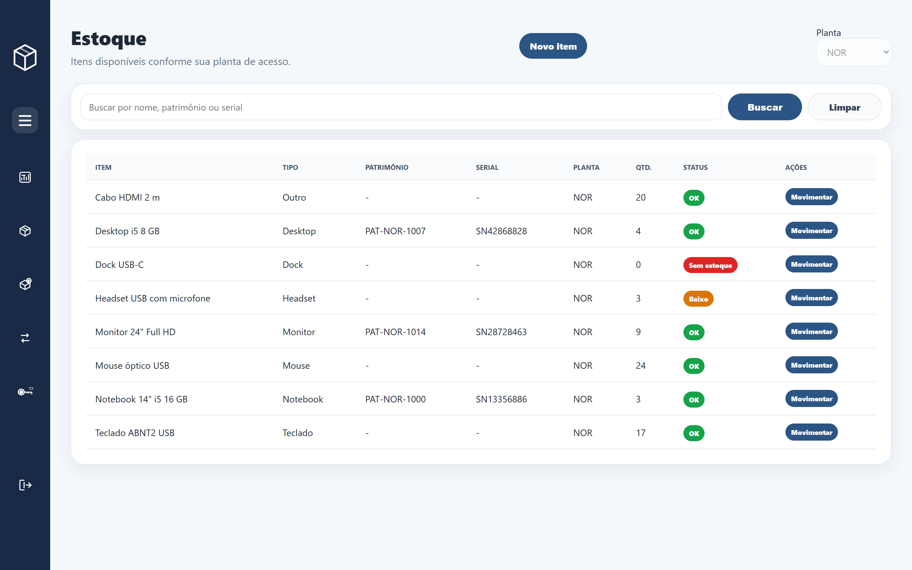
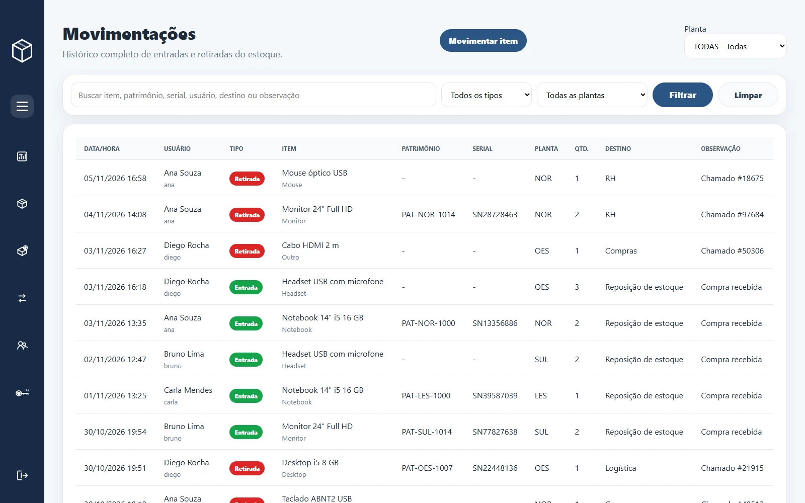
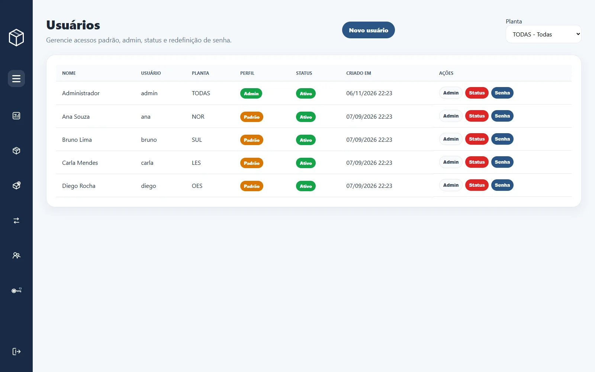
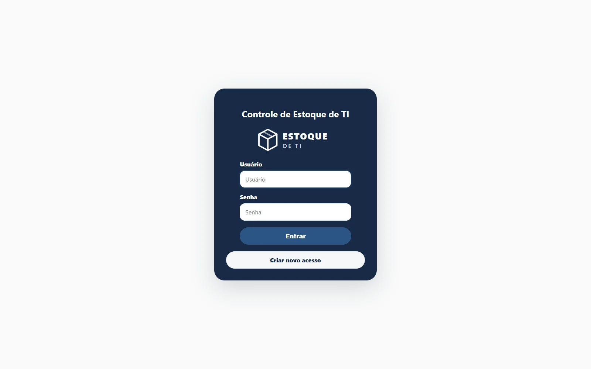

## Contexto

A empresa tem quatro fábricas, e cada uma tem o próprio estoque de TI: notebooks, desktops, monitores, periféricos e acessórios que a equipe local entrega aos colaboradores. O sistema foi feito para que cada fábrica controle o seu estoque e para que a gestão enxergue as quatro de uma vez.

## Desafio

- **Uma base, quatro estoques.** O técnico de uma fábrica não pode ver nem movimentar os itens de outra.
- **Visão consolidada.** O administrador precisa acompanhar todas as unidades juntas ou escolher uma.
- **Rastreabilidade.** Toda entrada e retirada tem que dizer quem fez, quando, quanto e para onde foi.
- **Alerta antes de faltar.** Itens abaixo do estoque mínimo precisam aparecer sem que alguém tenha de procurar.

## Solução

Uma aplicação Flask com SQLite em que **todo item pertence a uma unidade** e todo usuário tem uma planta de acesso. As consultas são filtradas no servidor pela planta de quem está logado, então um técnico só recebe os dados da própria fábrica. O administrador tem um seletor no topo para alternar entre as unidades ou ver todas.

O dashboard mostra quantos itens estão cadastrados, a quantidade total em estoque, quantos estão abaixo do mínimo e quantos zeraram, além das últimas movimentações.

### Estoque

Busca por nome, patrimônio ou serial, e cada item ganha um status calculado a partir do estoque mínimo: **OK**, **Baixo** ou **Sem estoque**.

O mesmo estoque, visto por uma técnica de uma única unidade: ela só enxerga os itens da própria planta, o seletor fica travado e o menu de usuários não aparece.

### Movimentações

Cada entrada ou retirada registra usuário, data e hora, quantidade, destino e observação (por exemplo, o número do chamado). A retirada não deixa o saldo ficar negativo. O histórico pode ser filtrado por tipo, planta e texto livre.

### Acessos

O administrador cria usuários, promove ou rebaixa perfis, desativa acessos e redefine senhas. As senhas seguem regras mínimas (8 caracteres, número e caractere especial) e ficam guardadas só como hash.

## Resultado

As quatro fábricas passaram a controlar o estoque de TI no mesmo sistema, cada uma restrita aos próprios itens, com histórico de quem retirou o quê e para onde. A gestão acompanha as unidades num só painel.

*Identidade visual, nomes das unidades, pessoas e dados desta página são genéricos e fictícios para preservar o cliente.*
