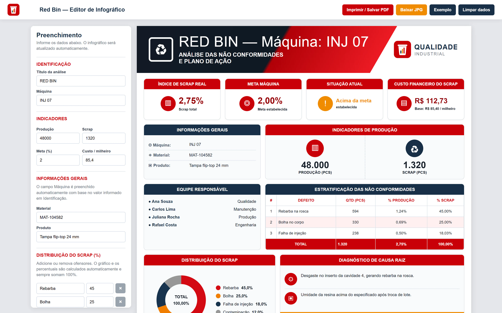
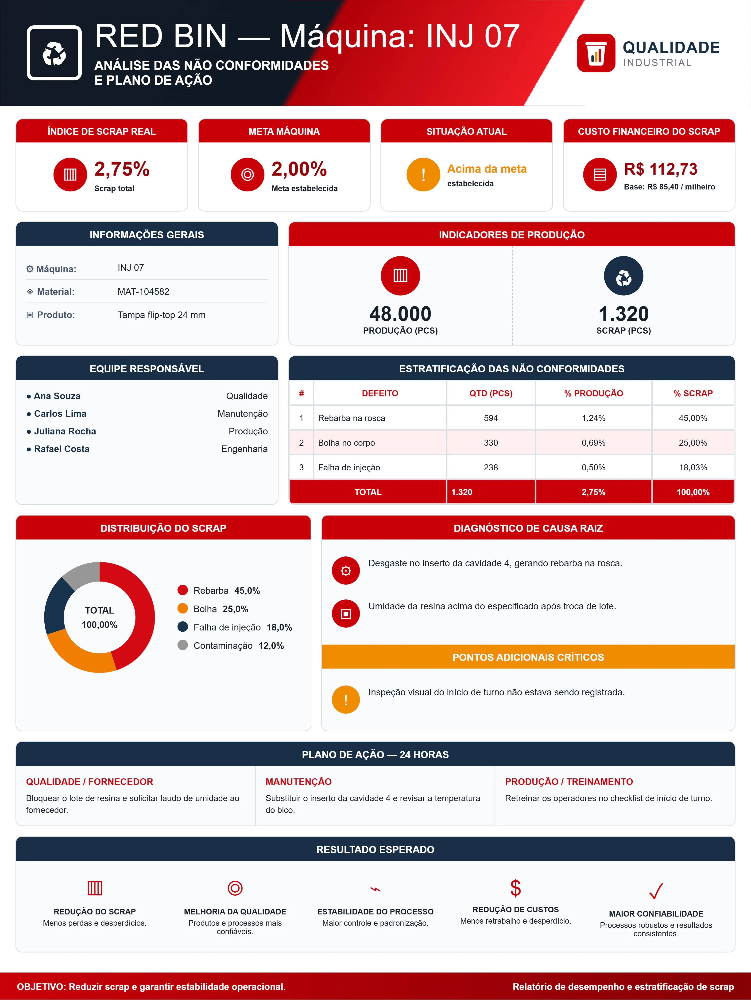

## Contexto

Na fábrica, o **Red Bin** reúne as peças reprovadas de uma máquina para análise. A equipe de Qualidade divulga o resultado de cada análise num comunicado interno: quanto foi perdido, por quê, quanto custou e o que será feito nas próximas 24 horas.

A ideia era que esse informativo saísse sempre igual: mesmo layout e mesmos blocos, mudando só os dados de cada análise.

## Desafio

- **Comunicado sempre igual.** Toda edição precisava seguir o mesmo layout, para que quem lê saiba onde encontrar cada informação.
- **Quem preenche é da Qualidade, não de design.** Montar a arte não podia exigir ferramenta de edição de imagem.
- **Contas sem erro.** Os percentuais e o custo precisavam sair direto dos números informados, sem calculadora no meio.

## Solução

Uma página com **formulário à esquerda e infográfico à direita**. Cada campo preenchido atualiza a arte na hora, e o resultado fica pronto para o comunicado.

O que é calculado sozinho:

- **Índice de scrap** (scrap ÷ produção) e comparação com a meta da máquina. O card de situação muda de cor e de texto quando o índice passa da meta.
- **Custo financeiro**, a partir do custo por milheiro.
- **Estratificação das não conformidades**: percentual de cada defeito sobre a produção e sobre o scrap.
- **Gráfico de rosca** da distribuição do scrap, desenhado em SVG. Os ofensores podem ser adicionados ou removidos, e os percentuais são arredondados de forma que a soma dá sempre 100%.

A equipe responsável também é uma lista dinâmica, com quantas pessoas forem necessárias. Quando a arte está pronta, um botão gera o **JPG em alta resolução** para anexar ao comunicado, e outro abre a impressão para salvar em PDF.

## O infográfico exportado

Esta é a imagem gerada pelo botão "Baixar JPG", preenchida com dados de exemplo:

## Resultado

A pessoa da Qualidade só informa os dados da análise. O layout, os cálculos e o gráfico ficam por conta da ferramenta, e cada comunicado sai no mesmo padrão do anterior.

*Logos e dados desta página foram substituídos por versões genéricas e fictícias para preservar o cliente.*
