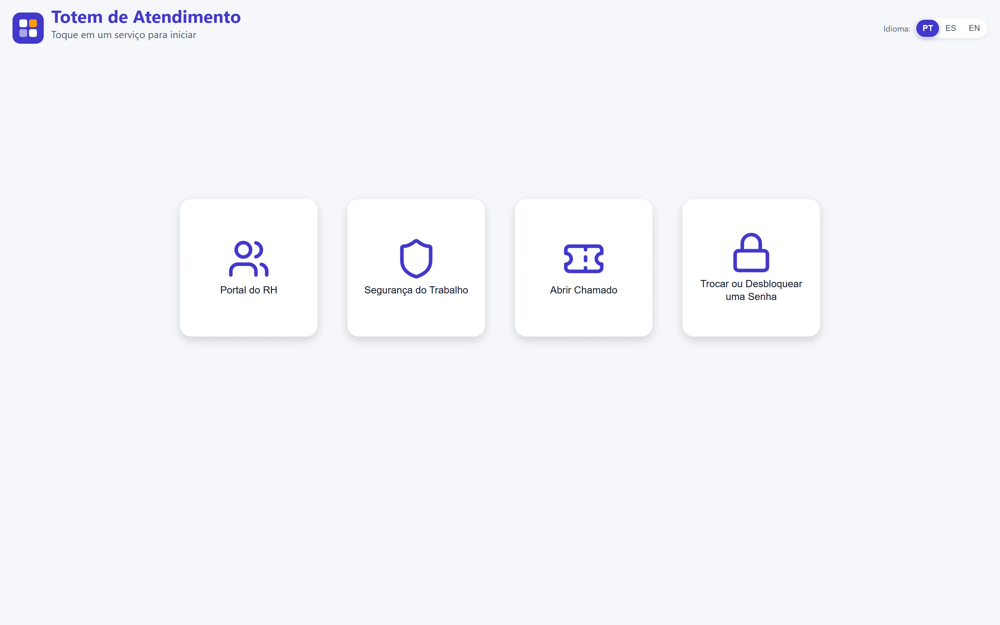
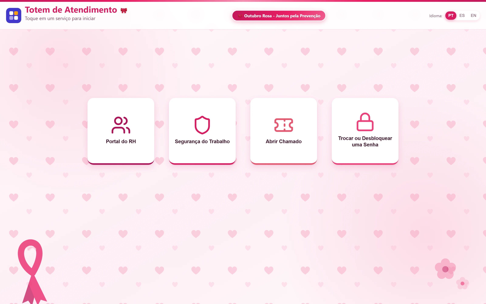
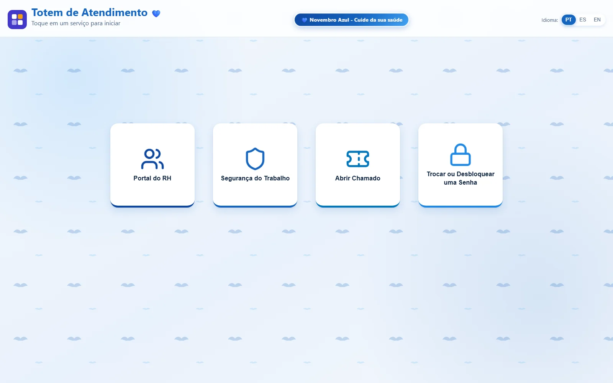
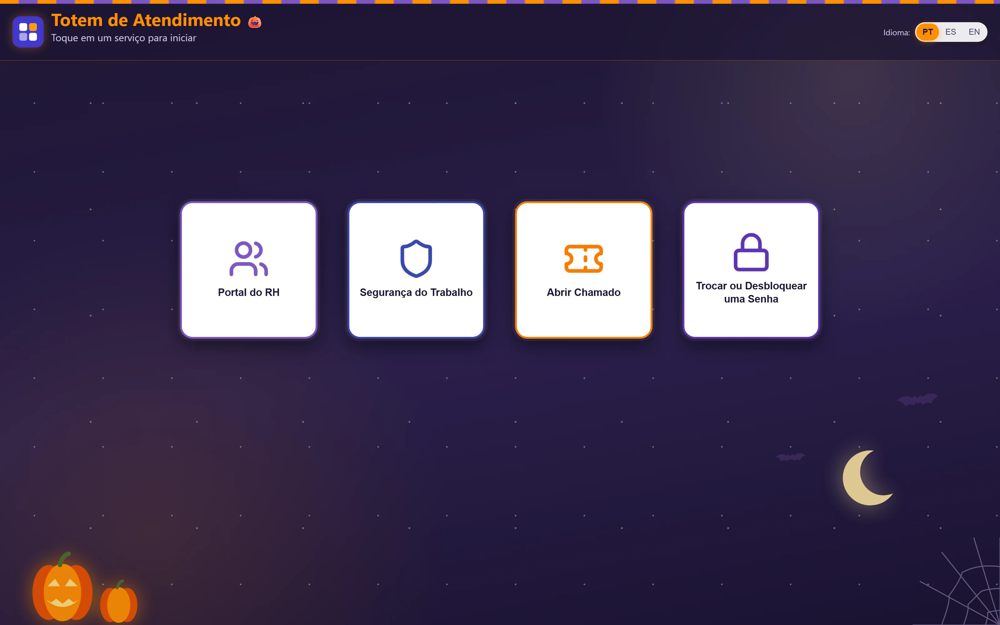
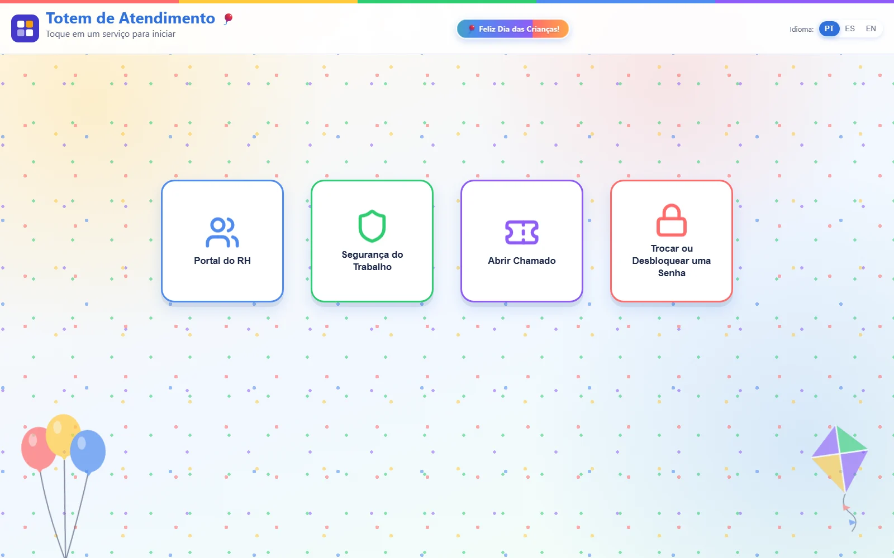
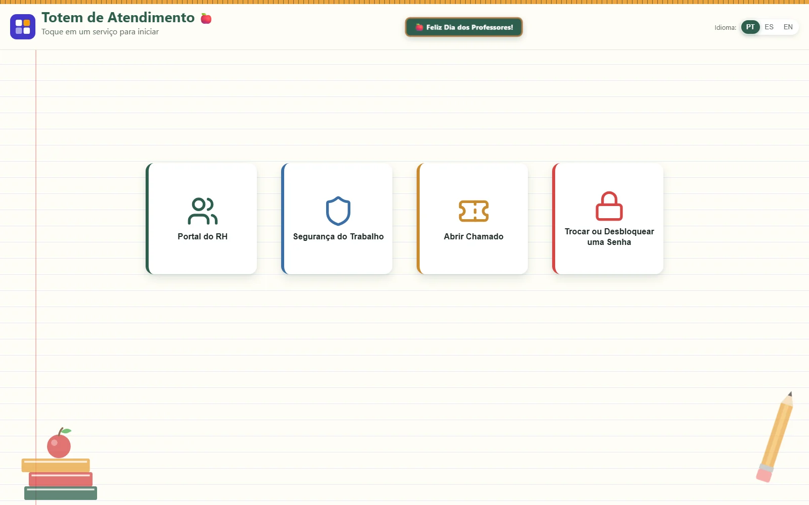
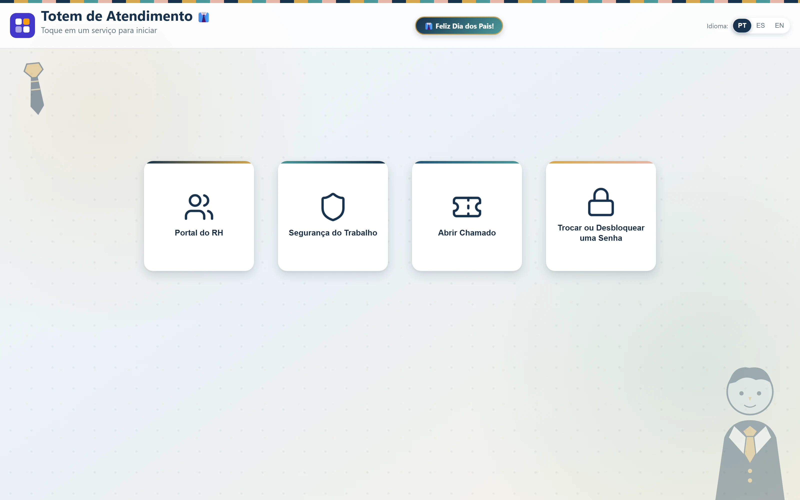

## Contexto

Na fábrica, nem todo colaborador tem computador. Para consultar o holerite, registrar uma ocorrência de segurança, abrir um chamado de TI ou desbloquear a senha, ele precisava pedir ajuda a alguém. A empresa instalou totens touch nas áreas comuns e precisava de uma tela única, simples de usar em pé e com um toque, que levasse cada pessoa ao portal certo.

## Desafio

- **Três idiomas** (português, espanhol e inglês), porque a operação recebe equipes de outros países.
- **Quem cuida do conteúdo não é programador.** Trocar um link, um texto ou ligar a campanha do mês não podia depender de deploy.
- **Totem é quiosque.** Nada de zoom, seleção de texto ou tela parada na página do último usuário.
- **Campanhas internas** (Outubro Rosa, Novembro Azul, datas comemorativas) precisavam aparecer no totem sem tirar o sistema do ar.

## Solução

Uma aplicação Flask em que **tudo o que muda fica num único arquivo de configuração**: idiomas, cards, links e temas. O servidor relê o arquivo assim que ele é salvo, e a mudança aparece nos totens sem reiniciar nada.

Se alguém salvar o arquivo com erro (uma vírgula esquecida, um link sem `https://`), a validação recusa a versão nova, **a tela continua com a última versão válida** e o motivo vai para o log. Um erro de digitação nunca derruba o totem.

O comportamento de quiosque fica no front-end: alvos de toque grandes, zoom e seleção bloqueados e recarga automática da tela quando ela fica parada. No navegador, o modo quiosque reinicia a sessão após alguns minutos sem uso e apaga os logins de quem usou o totem antes. Os arquivos estáticos levam a data de modificação na URL, e os totens baixam a versão nova sozinhos. Os ícones são servidos localmente, então a tela funciona mesmo sem acesso à internet.

## Temas sazonais

Cada tema muda cores, fundo e decorações e pode exibir uma mensagem no topo. Para ligar um tema, basta marcar `enabled: true`. A ordem da lista define a prioridade: o Outubro Rosa pode ficar ligado o mês inteiro, e o Dia dos Professores e o Halloween aparecem por cima dele nas datas certas. Temas de datas brasileiras aparecem só na versão em português.

## Resultado

O totem está em produção, rodando como serviço Windows e com monitoramento por um endpoint de saúde que informa o tema ativo em cada idioma. A equipe responsável troca textos, links e campanhas editando um arquivo, sem precisar de desenvolvedor nem de janela de manutenção.

*Identidade visual e links desta página foram substituídos por versões genéricas para preservar o cliente.*
